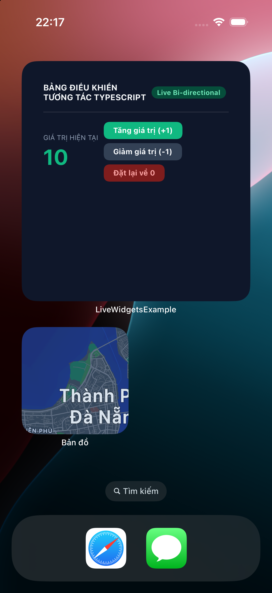

# react-native-live-widgets 🚀

<div align="center">

[](https://www.npmjs.com/package/react-native-live-widgets)
[](https://github.com/vu-tran/react-native-live-widgets)
[](https://www.typescriptlang.org/)
[](LICENSE)

**The Ultimate All-in-One Engine for Live Activities, Dynamic Island, and Interactive Home Screen Widgets in Bare React Native.**

*Write 100% Declarative TypeScript. Render dynamically to Native SwiftUI & Android 2D Canvas without touching Xcode or Android Studio.*

[📖 English Guide](docs/GUIDE-EN.md) • [🇻🇳 Hướng dẫn Tiếng Việt](docs/GUIDE-VI.md) • [✨ Features](#-key-features) • [⚡ Quick Start](#-quick-start)

---

</div>

## 📸 Showcase & Demos

| Dynamic Island (Expanded) | Interactive Home Screen Widget | Lock Screen Live Activity |
|:-------------------------:|:------------------------------:|:-------------------------:|
|  |  |  |
| *Segmented Progress & Realtime Timer* | *Buttons & Bi-directional State Sync* | *Multi-card KPI & Status Dashboard* |

---

## 💡 Why `react-native-live-widgets`?

Until now, adding **Live Activities** or **Home Screen Widgets** to a React Native app required writing hundreds of lines of complex Swift, SwiftUI, and Kotlin code, managing App Groups, Darwin notifications, and separate native target builds.

`react-native-live-widgets` solves this with a **Declarative TypeScript UI DSL**:
- 🚫 **No SwiftUI / Kotlin coding required** for custom screens.
- 🎨 **100% Declarative UI in React Native (`UI.VStack`, `UI.HStack`, `UI.Text`, `UI.Button`, `UI.Progress`)**.
- ⚡ **Interactive Buttons**: Tap buttons on the Home Screen Widget to run native Swift extensions or wake up TypeScript handlers.
- 🔄 **Realtime Data Sync (`SharedStorage`)**: Single source of truth across Main App, Lock Screen, and Home Screen.
- 🌐 **Silent Background Remote API Sync**: Automatically fetch REST APIs and update Widgets even when the App is **Force-Killed**.
- 🤖 **Android Parity**: Supports Android 16+ Promoted Live Notifications and Home Screen AppWidgets.

---

## ✨ Key Features

### 1. 🏝️ Dynamic Island & Lock Screen Live Activities (iOS 16.1+)
- **All Dynamic Island Modes**: `compactLeading`, `compactTrailing`, `minimal`, and `expanded`.
- **Realtime Timers & Progress**: Countdown timers, segmented progress bars, and battery/progress rings with zero battery drain.
- **Smart Dismissal Policies**: `immediate`, `afterDate`, or `default`.

### 2. 📱 Interactive Home Screen Widgets (iOS WidgetKit & Android AppWidget)
- Supports **Small**, **Medium**, and **Large** widget families.
- **Multi-page & Tabs**: Switch tabs or carousel pages directly on the widget (`actionId: "page:next"`).
- **Checklist & Toggles**: Toggle checkboxes and switch states without opening the app (`actionId: "toggle:<key>"`).
- **Dark & Light Mode**: Declarative color tokens `{ light: '#FFF', dark: '#0F172A' }`.

### 3. ⚡ Bi-directional Action Dispatcher (TypeScript + Native)
- Tap a widget button outside on the Home Screen to trigger a registered TypeScript function:
  ```ts
  LiveActivity.registerAction('action_checkin', async () => {
    // Runs inside React Native JS engine!
  });
  ```
- **App-Killed Protection**: Native fallback ensures UI responds instantly and persists data even if the main app is terminated.

### 4. 🌐 Background Remote API Sync (Zero Code Backend)
- Configure an API endpoint with `Widget.setRemoteConfig`:
  ```ts
  await Widget.setRemoteConfig('main', {
    url: 'https://api.yourcompany.com/v1/shifts/current',
    method: 'GET',
    refreshIntervalMinutes: 15
  }, APP_GROUP);
  ```
- The native Extension fetches fresh JSON and dynamically replaces `{{variables}}` in your widget layout in the background.

### 5. 🔔 APNs & FCM Token Management
- One-call retrieval for all push tokens:
  ```ts
  const tokens = await LiveActivity.getAllPushTokens();
  // tokens.devicePushToken
  // tokens.pushToStartToken (iOS 17.2+)
  // tokens.activityUpdateToken
  ```

### 6. 🎵 Background Audio & Media Notification
- Integrated with `MPNowPlayingInfoCenter` on iOS and `MediaStyle` Notifications on Android for audio playback status.

---

## ⚡ Quick Start

### 1. Installation

```bash
npm install react-native-live-widgets
# or
yarn add react-native-live-widgets
```

### 2. Auto-Configuration CLI

Run the automated scaffolding script in your React Native project root:

```bash
npx react-native-live-widgets init --group group.com.yourcompany.app
```

This will automatically:
- Inject `NSSupportsLiveActivities` and `NSSupportsLiveActivitiesFrequentUpdates` into `Info.plist`.
- Scaffold the `LiveWidgetsExtension` bundle in your `ios/` folder.
- Configure `AndroidManifest.xml` with required notification permissions.

### 3. Install Pods

```bash
cd ios && pod install
```

---

## 💻 Code Example

### 1. Start a Live Activity with Dynamic Island

```tsx
import { UI, LiveActivity } from 'react-native-live-widgets';

await LiveActivity.start({
  activityId: 'order_1024',
  dynamicIsland: {
    compactLeading: UI.Image({ systemName: 'bag.fill', tintColor: '#10B981' }),
    compactTrailing: UI.Text('15 phút', { color: '#10B981', fontWeight: 'bold' }),
    minimal: UI.Image({ systemName: 'bag.fill', tintColor: '#10B981' }),
    expanded: UI.VStack(
      { padding: 14, spacing: 8 },
      UI.HStack(
        { justifyContent: 'spaceBetween' },
        UI.Text('ĐƠN HÀNG #1024', { fontSize: 11, color: '#94A3B8' }),
        UI.Badge({ text: 'Đang giao', backgroundColor: '#064E3B', textColor: '#6EE7B7' })
      ),
      UI.Text('Tài xế đang đến điểm giao', { fontSize: 15, fontWeight: 'bold', color: '#FFFFFF' }),
      UI.Progress({
        style: 'bar',
        value: 0.75,
        tintColor: '#10B981',
        trackColor: '#334155'
      })
    )
  },
  lockScreen: UI.VStack(
    { padding: 16, backgroundColor: '#0F172A' },
    UI.Text('GIAO HÀNG TIẾT KIỆM', { fontSize: 11, color: '#38BDF8' }),
    UI.Text('Dự kiến nhận lúc 11:30', { fontSize: 16, fontWeight: 'bold', color: '#FFFFFF' })
  )
});
```

### 2. Update Home Screen Widgets

```tsx
import { UI, Widget } from 'react-native-live-widgets';

const APP_GROUP = 'group.com.yourcompany.app';

await Widget.setLayout('main', {
  small: UI.VStack(
    { padding: 12, backgroundColor: '#0F172A' },
    UI.Text('CA LÀM VIỆC', { fontSize: 10, color: '#94A3B8' }),
    UI.Text('Ca sáng', { fontSize: 16, fontWeight: 'bold', color: '#FFFFFF' }),
    UI.Spacer(),
    UI.Button('Chấm công', {
      actionId: 'action_checkin',
      backgroundColor: '#10B981',
      textColor: '#FFFFFF'
    })
  )
}, APP_GROUP);

await Widget.reloadAll();
```

---

## 📊 Platform Feature Parity Matrix

| Feature | iOS 16.1+ | Android (API 24 - 36) |
| :--- | :---: | :---: |
| **Declarative UI Engine (`UI.*`)** | SwiftUI dynamic tree | High-DPI Canvas 2D Bitmap |
| **Dynamic Island (All 4 layouts)** | ✅ Supported | 🔄 Mapped to Promoted Ongoing (Android 16+) |
| **Lock Screen Live Activity** | ✅ Supported | ✅ Ongoing Rich Notification |
| **Home Screen Widgets** | Small, Medium, Large | Resizable Grid AppWidgets |
| **Interactive Buttons** | iOS 17+ AppIntents | RemoteViews PendingIntent |
| **SharedStorage Data Sync** | App Group UserDefaults | Context SharedPreferences |
| **Remote API Silent Sync** | Background Timeline URLSession | WorkManager / Background Fetch |
| **Push Remote Updates** | Apple APNs Activity Tokens | Firebase Cloud Messaging (FCM) |

---

## 📚 Documentation

- 🇬🇧 **[Full English Developer Guide](docs/GUIDE-EN.md)**: Architecture, DSL specs, push notification server configuration, and best practices.
- 🇻🇳 **[Hướng dẫn Chi tiết bằng Tiếng Việt](docs/GUIDE-VI.md)**: Hướng dẫn tích hợp từng bước, thiết lập App Group, giải quyết lỗi thường gặp.

---

## 🤝 Contributing

Contributions are welcome! Please feel free to submit a Pull Request or open an Issue.

1. Fork the Project.
2. Create your Feature Branch (`git checkout -b feature/AmazingFeature`).
3. Commit your Changes (`git commit -m 'Add some AmazingFeature'`).
4. Push to the Branch (`git push origin feature/AmazingFeature`).
5. Open a Pull Request.

---

## 📄 License

Distributed under the **MIT License**. See `LICENSE` for more information.

Developed with ❤️ by **vu-tran** for high-performance React Native applications.
