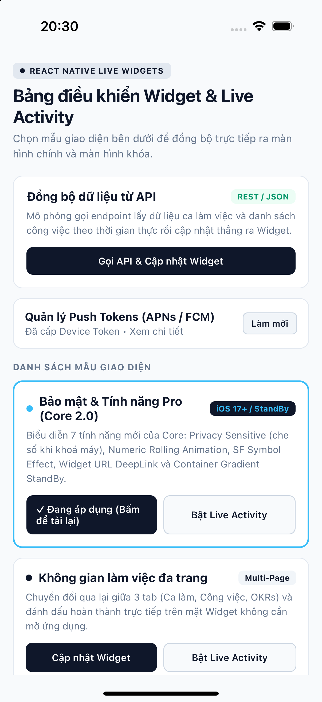
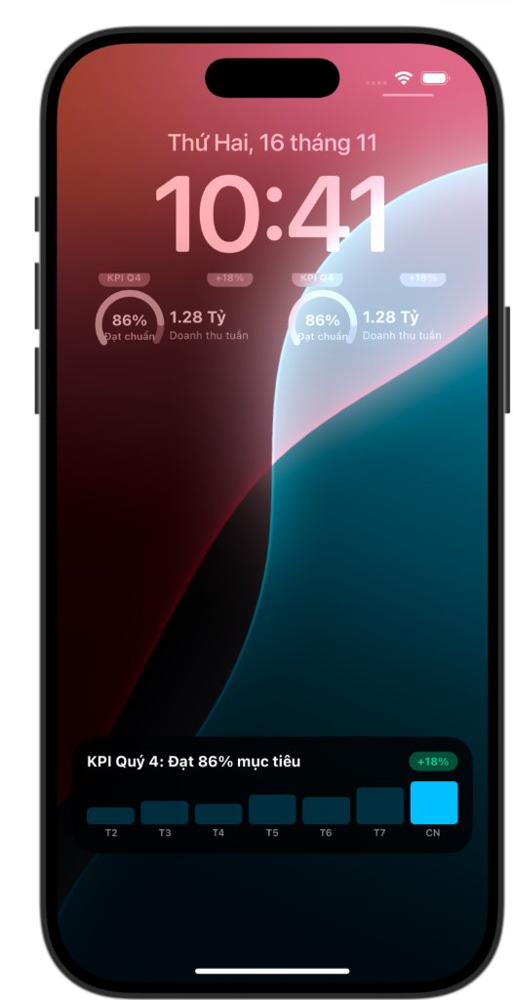
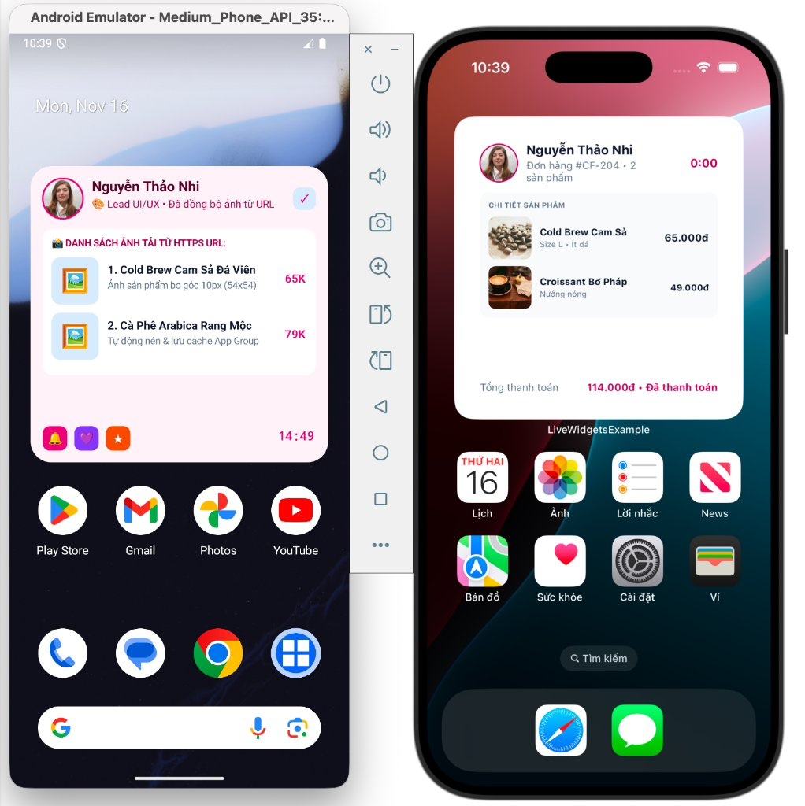

# react-native-live-widgets 🚀

<div align="center">

[](https://www.npmjs.com/package/react-native-live-widgets)
[](https://expo.dev)
[](https://github.com/React-Native-Vu/react-native-live-widgets)
[](https://www.typescriptlang.org/)
[](LICENSE)

**The Ultimate All-in-One Engine for Live Activities, Dynamic Island, and Interactive Home Screen Widgets in React Native & Expo.**

*Write 100% Declarative TypeScript. Render dynamically to Native SwiftUI (WidgetKit) & Android 2D Canvas without touching Xcode or Android Studio.*

[📖 English Guide](docs/GUIDE-EN.md) • [🇻🇳 Hướng dẫn Tiếng Việt](docs/GUIDE-VI.md) • [📱 Bare RN Demo](https://github.com/React-Native-Vu/LiveWidgetsExample) • [⚡ Expo Demo](https://github.com/React-Native-Vu/LiveWidgetsExampleExpo) • [✨ Tính năng](#-key-features) • [⚡ Cài đặt](#-quick-start) • [☕ Ủng hộ tác giả](#-sponsor--donate-ủng-hộ-tác-giả)

---

</div>

## 📱 Live Demo Example Apps

Full, ready-to-run demo applications are available on GitHub for both architectures:

| Platform | Repository | Description |
| :--- | :--- | :--- |
| **⚛️ Bare React Native CLI** | 👉 **[React-Native-Vu/LiveWidgetsExample](https://github.com/React-Native-Vu/LiveWidgetsExample)** | Full Xcode Widget Extension & Android Studio setup |
| **🚀 Expo (SDK 58 / CNG)** | 👉 **[React-Native-Vu/LiveWidgetsExampleExpo](https://github.com/React-Native-Vu/LiveWidgetsExampleExpo)** | Continuous Native Generation via Expo Config Plugin |

### ✨ Highlights of Both Demos:
- 🚀 **100% Pre-configured**: Xcode App Groups, `WidgetExtension`, and Android `AppWidgetProvider` ready out of the box.
- 🎨 **5 Real-world Presets**:
  1. **Executive KPI Dashboard**: Live sales sync, circular progress ring, and weekly chart.
  2. **Coffee Delivery Tracker**: Dynamic Island countdown and delivery driver status.
  3. **Interactive Task Checklist**: Check off items right from your Home Screen without opening the app.
  4. **Music & Audio Player**: Dynamic Island equalizer animation and lock screen media style.
  5. **Flight Status**: Real-time gate, departure time, and airport progress bar.
- 🔄 **Bidirectional Real-Time Sync**: Instant state updates between Main App and WidgetKit.

#### 1. Clone & Run Bare React Native Demo:
```bash
git clone https://github.com/React-Native-Vu/LiveWidgetsExample.git
cd LiveWidgetsExample && npm install
npx react-native run-ios # or npx react-native run-android
```

#### 2. Clone & Run Expo Demo:
```bash
git clone https://github.com/React-Native-Vu/LiveWidgetsExampleExpo.git
cd LiveWidgetsExampleExpo && npm install
npx expo prebuild
npx expo run:ios # or npx expo run:android
```

---

## 📸 Showcase & Demos

<div align="center">
  <table>
    <tr>
      <td width="50%" align="center">
        <b>🏝️ Dynamic Island Expanded & KPI Dashboard</b><br/><br/>
        
      </td>
      <td width="50%" align="center">
        <b>📱 Interactive Home Screen Widget (iOS)</b><br/><br/>
        
      </td>
    </tr>
    <tr>
      <td width="50%" align="center">
        <b>🔒 Lock Screen Live Activity & Gauges</b><br/><br/>
        
      </td>
      <td width="50%" align="center">
        <b>🤖 100% Feature Parity (Android & iOS)</b><br/><br/>
        
      </td>
    </tr>
  </table>
</div>

---

## 💡 Why `react-native-live-widgets`?

Until now, adding **Live Activities** or **Home Screen Widgets** to a React Native app required writing hundreds of lines of complex Swift, SwiftUI, and Kotlin code, managing App Groups, Darwin notifications, and separate native target builds.

`react-native-live-widgets` solves this with a **Declarative TypeScript UI DSL**:
- 🚫 **No SwiftUI / Kotlin coding required** for custom screens.
- 🎨 **100% Declarative UI in React Native (`UI.VStack`, `UI.HStack`, `UI.Text`, `UI.Button`, `UI.Progress`, `UI.Image`)**.
- 🚀 **Full Expo & EAS Build Support** via automated Expo Config Plugin (`app.plugin.js`).
- ⚡ **Interactive Buttons**: Tap buttons on the Home Screen Widget to run native Swift extensions or wake up TypeScript handlers.
- 🔄 **Realtime Data Sync (`SharedStorage`)**: Single source of truth across Main App, Lock Screen, and Home Screen.
- 🌐 **Silent Background Remote API Sync**: Automatically fetch REST APIs and update Widgets even when the App is **Force-Killed**.
- 🤖 **Android Parity**: Supports Android 16+ Promoted Live Notifications and Home Screen AppWidgets.

---

## ✨ Key Features

### 1. 🏝️ Dynamic Island & Lock Screen Live Activities (iOS 16.1+)
- **All Dynamic Island Modes**: `compactLeading`, `compactTrailing`, `minimal`, and `expanded`.
- **Realtime Timers & Progress**: Countdown timers, segmented progress bars, and battery/progress rings with zero battery drain.
- **Smart Dismissal Policies**: `immediate`, `afterDate`, or `default`.

### 2. 📱 Interactive Home Screen Widgets (iOS WidgetKit & Android AppWidget)
- Supports **Small**, **Medium**, and **Large** widget families.
- **Multi-page & Tabs**: Switch tabs or carousel pages directly on the widget (`actionId: "page:next"`).
- **Checklist & Toggles**: Toggle checkboxes and switch states without opening the app (`actionId: "toggle:<key>"`).
- **Dark & Light Mode**: Declarative color tokens `{ light: '#FFF', dark: '#0F172A' }`.

### 3. ⚡ Bi-directional Action Dispatcher (TypeScript + Native)
- Tap a widget button outside on the Home Screen to trigger a registered TypeScript function:
  ```ts
  LiveActivity.registerAction('action_checkin', async (payload) => {
    // Runs inside React Native JS engine!
    console.log('Action triggered from Home Screen Widget:', payload);
  });
  ```
- **App-Killed Protection**: Native fallback ensures UI responds instantly and persists data even if the main app is terminated.

### 4. 🌐 Background Remote API Sync (Zero Code Backend)
- Configure an API endpoint with `Widget.setRemoteConfig`:
  ```ts
  await Widget.setRemoteConfig('main', {
    url: 'https://api.yourcompany.com/v1/shifts/current',
    method: 'GET',
    refreshIntervalMinutes: 15
  }, APP_GROUP);
  ```
- The native Extension fetches fresh JSON and dynamically replaces `{{variables}}` in your widget layout in the background.

### 5. 🔔 APNs & FCM Token Management
- One-call retrieval for all push tokens:
  ```ts
  const tokens = await LiveActivity.getAllPushTokens();
  // tokens.devicePushToken
  // tokens.pushToStartToken (iOS 17.2+)
  // tokens.activityUpdateToken
  ```

---

## ⚡ Quick Start

### 1. Installation

```bash
# React Native CLI
npm install react-native-live-widgets

# Expo (Managed or Bare)
npx expo install react-native-live-widgets
```

---

### 2. Configuration

#### A. If using Expo (Config Plugin)

Add `react-native-live-widgets` to your `app.json` or `app.config.js`:

```json
{
  "expo": {
    "name": "My Expo App",
    "plugins": [
      [
        "react-native-live-widgets",
        {
          "appGroup": "group.com.yourcompany.app",
          "enableLiveActivities": true,
          "frequentUpdates": true
        }
      ]
    ]
  }
}
```

Then generate native projects or run with Expo Dev Client:

```bash
npx expo prebuild
# Run on iOS & Android:
npx expo run:ios
npx expo run:android
```

#### B. If using Bare React Native CLI

Run the automated scaffolding script in your React Native project root:

```bash
npx react-native-live-widgets init --group group.com.yourcompany.app
```

This will automatically:
- Inject `NSSupportsLiveActivities` and `NSSupportsLiveActivitiesFrequentUpdates` into `Info.plist`.
- Scaffold the `LiveWidgetsExtension` bundle in your `ios/` folder.
- Configure `AndroidManifest.xml` with required notification permissions.

And install CocoaPods dependencies:

```bash
cd ios && pod install
```

---

## 💻 Code Example

### 1. Start a Live Activity with Dynamic Island

```tsx
import { UI, LiveActivity } from 'react-native-live-widgets';

await LiveActivity.start({
  activityId: 'kpi_q4_2026',
  dynamicIsland: {
    compactLeading: UI.Text('KPI Q4', { color: '#38BDF8', fontWeight: 'bold' }),
    compactTrailing: UI.Text('86%', { color: '#10B981', fontWeight: 'bold' }),
    minimal: UI.Text('86%', { color: '#10B981' }),
    expanded: UI.VStack(
      { padding: 14, spacing: 8, backgroundColor: '#0F172A' },
      UI.HStack(
        { justifyContent: 'spaceBetween' },
        UI.Text('BẢNG ĐIỀU HÀNH KPI', { fontSize: 11, color: '#94A3B8' }),
        UI.Badge({ text: '86% Hoàn thành', backgroundColor: '#064E3B', textColor: '#6EE7B7' })
      ),
      UI.Text('Mục tiêu Q4/2026', { fontSize: 16, fontWeight: 'bold', color: '#FFFFFF' }),
      UI.Progress({
        style: 'bar',
        value: 0.86,
        tintColor: '#10B981',
        trackColor: '#334155'
      }),
      UI.Text('Doanh số 12.8 tỷ / 15 tỷ VNĐ • Tăng trưởng +22%', { fontSize: 12, color: '#94A3B8' })
    )
  },
  lockScreen: UI.VStack(
    { padding: 16, backgroundColor: '#0F172A', cornerRadius: 16 },
    UI.HStack(
      { justifyContent: 'spaceBetween' },
      UI.Text('KPI Quý 4: Đạt 86% mục tiêu', { fontSize: 14, fontWeight: 'bold', color: '#FFFFFF' }),
      UI.Badge({ text: '+18%', backgroundColor: '#064E3B', textColor: '#6EE7B7' })
    ),
    UI.Progress({
      style: 'segmented',
      segments: 7,
      currentSegment: 6,
      tintColor: '#38BDF8',
      trackColor: '#1E293B'
    })
  )
});
```

### 2. Configure Home Screen Widget with Live Sync

```tsx
import { UI, Widget, SharedStorage } from 'react-native-live-widgets';

const APP_GROUP = 'group.com.yourcompany.app';

// Set shared data
await SharedStorage.set('kpi_percent', '86', APP_GROUP);
await SharedStorage.set('revenue_month', '4.85 Tỷ đ', APP_GROUP);

// Build Declarative Layout
await Widget.setLayout('main', {
  large: UI.VStack(
    { padding: 16, backgroundColor: '#0B132B', cornerRadius: 20 },
    UI.HStack(
      { justifyContent: 'spaceBetween' },
      UI.Text('TỔNG QUAN ĐIỀU HÀNH (KPI & BIỂU ĐỒ)', { fontSize: 11, color: '#38BDF8', fontWeight: 'bold' }),
      UI.Badge({ text: 'LIVE SYNC', backgroundColor: '#064E3B', textColor: '#6EE7B7' })
    ),
    UI.HStack(
      { spacing: 12, marginTop: 10 },
      UI.VStack(
        { width: 90, alignItems: 'center' },
        UI.Progress({ style: 'circular', value: 0.86, tintColor: '#38BDF8', trackColor: '#1E293B' }),
        UI.Text('86%', { fontSize: 16, fontWeight: 'bold', color: '#FFFFFF' }),
        UI.Text('KPI Quý', { fontSize: 10, color: '#94A3B8' })
      )
    ),
    UI.Spacer(),
    UI.Button('Duyệt báo cáo doanh thu tuần', {
      actionId: 'action_approve_report',
      backgroundColor: '#1E293B',
      textColor: '#FFFFFF'
    })
  )
}, APP_GROUP);

await Widget.reloadAll();
```

---

## 📊 Platform Feature Parity Matrix

| Feature | iOS 16.1+ | Android (API 24 - 36) |
| :--- | :---: | :---: |
| **Declarative UI Engine (`UI.*`)** | SwiftUI dynamic tree | High-DPI Canvas 2D Bitmap |
| **Dynamic Island (All 4 layouts)** | ✅ Supported | 🔄 Mapped to Promoted Ongoing (Android 16+) |
| **Lock Screen Live Activity** | ✅ Supported | ✅ Ongoing Rich Notification |
| **Home Screen Widgets** | Small, Medium, Large | Resizable Grid AppWidgets |
| **Interactive Buttons** | iOS 17+ AppIntents | RemoteViews PendingIntent |
| **SharedStorage Data Sync** | App Group UserDefaults | Context SharedPreferences |
| **Remote API Silent Sync** | Background Timeline URLSession | WorkManager / Background Fetch |
| **Push Remote Updates** | Apple APNs Activity Tokens | Firebase Cloud Messaging (FCM) |
| **Expo & EAS Build Ready** | ✅ Automated Config Plugin | ✅ Automated Config Plugin |

---

## ☕ Sponsor & Donate (Ủng hộ tác giả)

`react-native-live-widgets` là dự án mã nguồn mở **hoàn toàn miễn phí (100% Free & MIT License)**, được phát triển và duy trì với tâm huyết mang lại giải pháp Live Activities & Widgets tốt nhất cho cộng đồng React Native Việt Nam và quốc tế.

Nếu thư viện này giúp ích cho dự án hoặc công ty của bạn, bạn có thể **mời tác giả một tách cà phê** để tiếp thêm động lực phát triển thêm nhiều tính năng mới nhé! ☕❤️

<div align="center">


### 🏦 Thông tin chuyển khoản ủng hộ:
- **Ngân hàng**: VPBank (Ngân hàng TMCP Việt Nam Thịnh Vượng)
- **Số tài khoản / Số điện thoại**: `0906472426`
- **Chủ tài khoản**: `TRAN LE VU`
- **Nội dung**: `LiveWidgets Support` hoặc lời nhắn của bạn

*Chân thành cảm ơn sự đồng hành và ủng hộ quý báu của bạn!* 🙏✨

</div>

---

## 📚 Documentation & Guides

- 📱 **[LiveWidgetsExample Demo Project](https://github.com/React-Native-Vu/LiveWidgetsExample)**: Complete working sample app demonstrating all 5 presets with bidirectional sync on iOS & Android.
- 🇬🇧 **[Full English Developer Guide](docs/GUIDE-EN.md)**: Architecture, DSL specs, push notification server configuration, and best practices.
- 🇻🇳 **[Hướng dẫn Chi tiết bằng Tiếng Việt](docs/GUIDE-VI.md)**: Hướng dẫn tích hợp từng bước, thiết lập App Group, giải quyết lỗi thường gặp.

---

## 🤝 Contributing

Contributions are welcome! Please feel free to submit a Pull Request or open an Issue on [GitHub Repository](https://github.com/React-Native-Vu/react-native-live-widgets).

---

## 📄 License

Distributed under the **MIT License**. See [LICENSE](LICENSE) for more information.

Developed with ❤️ by **vu-tran** for high-performance React Native & Expo applications.
